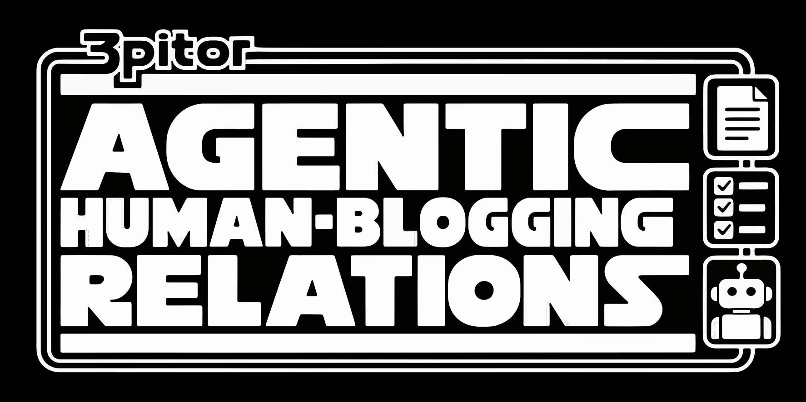

# 3pitor



An editor for blog posts written in markdown, with Claude built in. You edit posts in a rich text editor and work on
them with Claude in a chat panel. Claude never writes a post's text; it can make a new post, holding only its title as
a heading, and save its own notes under `.3pitor/`. Its edits appear in the editor as unsaved changes, merged with anything you type while it
works, and only your Save writes them.

It is built on Bun + TypeScript, Hono, and the Vercel AI SDK (v7). Each chat runs on the provider, model, and thinking
level you pick when you start it: Claude through the `claude` program you already have installed (your Claude
subscription), Claude through the Anthropic API, OpenAI, Google Gemini, or a model you have pulled into Ollama. Only the
local Claude provider needs a `claude` program; 3pitor never installs one.

All code lives in `src/`, organized by package, then by feature, then by component within the feature.

## How `src/` is laid out

- **Packages.** Eight packages, and imports run one way only:
  - `src/cli/` is the `3pitor` command. It reads the command line and environment, chooses the workspace folder,
    builds the file system, starts the engine with it, hands the engine to the server, and opens the browser. It
    imports `engine/engine.ts`, `server/server.ts`, `file-system/file-system.ts`, and `app-files/app-files.ts`.
    Nothing imports it.
  - `src/server/` holds all the HTTP and WebSocket code. It reaches the engine only through `engine/engine.ts`, and it
    is the one package that imports `ui/index.html`, from `server.ts`, to serve the page.
  - `src/engine/` holds everything else: chat sessions, the agent, and how chat reaches Claude. It knows
    nothing about HTTP or WebSockets, and does no file I/O itself. It imports only `src/shared/`,
    `src/file-system/file-system.ts` (contract symbols only), `src/posts/posts.ts` (with `import type` only, so no
    post store ever loads into it), `src/posts/post-error.ts` (as a value, to recognize a refusal), and npm packages.
    - Its production code uses no Bun-only API, `bun` or `bun:*` import, import attribute, or `import.meta` field, so
      a host other than Bun can reuse it. Two checks in `make test` enforce this: `engine/bun-free.test.ts` scans the
      source, and `make check-node` loads the engine on Node and runs a `claude` call through it. So `make test`
      needs Node 22.15 or later as well as Bun. Engine tests and their helpers may still use Bun.
    - A host gives it five inputs: a `FileSystem` (including `glob`), a `PostStore` over the same workspace,
      `serveTools`, `isOnPath` (whether a program is on a `PATH`, used once at startup), and `appSkillFiles` (the
      app's own skill files, as a map of path to text). 3pitor's own are Bun code: `createLocalFileSystem`, the server's MCP endpoint, `Bun.which`, and the
      app-files macro. The engine's relative imports name no file extension, so a host bundles it, or loads it the
      way `make check-node` does.
  - `src/file-system/` holds every runtime file read and write behind `file-system.ts`: a key-based `FileSystem`, its
    local-disk implementation, and workspace choice. It imports no other package.
  - `src/posts/` holds posts as records with stable ids, behind the `PostStore` contract in `posts.ts`, and the first
    store, which keeps them in workspace folders. It imports only `file-system/file-system.ts` and `src/shared/`. Only
    cli, server, and engine may import it, and only through `posts.ts` and `post-error.ts`: cli builds the store, the
    engine takes it, and the server's post routes recognize its refusals.
  - `src/app-files/` finds and embeds files from the app's own source tree: `SRC`, `WORKSPACE_FIXTURE`, and
    `APP_SKILL_FILES`, through its entry `app-files.ts`. Only a Bun host can do this. It imports no other package. In
    production only cli and `server/scripts/check.ts` import it; tests may too, and engine production code never does.
  - `src/ui/` runs in the browser, and `src/shared/` holds what the browser and server-side code both use. `src/ui/` imports
    none of cli, server, engine, file-system, or posts; `src/shared/` imports no package.
- **Features.** Each package is split into feature folders. A capability that spans packages uses the same name in
  each, so `chat` and `events` exist under `src/engine/`, `src/server/`, and `src/ui/`. Posts are the exception: the
  server's `posts/` routes serve the UI's `documents/` feature, which holds the editor, the post table, and the post
  panel, and the engine hands on the store rather than wrapping it.
- **Components.** A feature with more than one component has one folder per component. A component is one module,
  plus the helpers only it imports, plus its tests and CSS. A feature with a single component keeps its files directly
  in the feature folder. Who imports a module decides where it goes, not whether it is a React component or has CSS:
  a module only one component uses sits flat in that component's folder, CSS and test beside it (the editor's popups,
  the post table, the model picker).
- **`components/` folders.** Code shared by siblings goes in a `components/` folder at the lowest level that covers
  everything that uses it. Inside a `components/` folder, a module with its own CSS gets a folder of its own
  (`menu/`, `confirm-dialog/`), and one without sits flat (`api.ts`). Code shared by components of one feature goes in
  `<feature>/components/`. Code shared by
  features of one package goes in `<package>/components/`. Code shared by the browser and server-side code goes in
  `src/shared/`. Here "components" means shared by siblings, not React components: a fetch helper and a test-only
  model both live in one.
- **Entry points.** The one entry point, `src/cli/cli.ts`, sits at its package root. That keeps the paths in
  `Makefile` and `package.json` stable.

### `src/cli/`

- `cli.ts` is the entry point. It parses the command line, picks the workspace folder with `chooseWorkspace`, builds
  the file system with `createLocalFileSystem` and the post store over it with `createFilePostStore`, then calls the engine's `startEngine` and the server's `startServer`,
  prints the `listening on` line, and opens the browser. It reads `WORKSPACE`, `PORT`, `NODE_ENV` and `OPEN_BROWSER`,
  and hands the engine the environment for the API keys, `PATH`, and `OLLAMA_HOST`, so neither the server nor the file
  system reads the environment.
- `cli.test.ts` starts `cli.ts` from source the way a person would. It finds `cli.ts` from its own folder, so the two
  must stay side by side.
- `command-line.ts` turns the command line into the folder argument, or a request to print the version or usage.

### `src/server/`

Each feature's `*.routes.ts` file holds its Hono routes. A handler pulls what it needs out of the request, checks its
shape, and hands it to its slice of the engine, such as `engine.posts`. The server alone turns failures into
status codes. The one exception is the post routes' create, title, and body handlers, which also keep a post's title
and its first `#` heading in step, with `src/shared/title-row.ts`.

- `server.ts` exports `startServer(engine, { port, development })`. It mounts every feature's routes on one Hono app,
  which serves REST endpoints, the AI SDK UI message stream (SSE) for chat, and a Bun-native WebSocket for events. It
  also serves the page and `/api/health`. It re-exports `serveTools`, which `cli.ts` hands to the engine. It listens
  on `127.0.0.1` only, and answers 403 to any request whose `Host` is not its own or whose `Origin` is another site's,
  event socket included, since no endpoint asks who is calling.
- **`chat/`:**
  - `sessions/sessions.routes.ts` serves chat sessions, and turns the engine's chat stream into an SSE response.
  - `models/models.routes.ts` serves the New chat picker's catalog.
  - `mcp-endpoint/mcp-endpoint.ts` exports `serveTools`. It lends 3pitor's tools to `claude` over MCP's HTTP
    transport for one model call, on a loopback port, so its edits still land on the turn's copy. Its tests also run
    the real round trips, where the fake `claude` calls the tools.
- `posts/posts.routes.ts` serves the post store behind `engine.posts`. It maps each `PostError` to a 404 or 400
  carrying the store's own sentence, and a body that does not fit to a 400, each as `{ "error": … }`. An id that names
  no post is a 404, whatever it holds. A new post starts with `# <title>`, a rename rewrites the post's first `#`
  heading (or adds one at the top), and a Save whose first `#` heading is not blank makes that heading's text the
  title. Titles are stored with their whitespace tidied.
- `events/events.routes.ts` is the event bus's WebSocket.
- `view-state/view-state.routes.ts` and `workspace-config/workspace-config.routes.ts` serve those features.
- **`scripts/check.ts`:** the end-to-end check, which starts `cli/cli.ts`. `scripts/` is a named exception to the
  feature rule: it is dev tooling, `package.json`'s `check` script names it by path, and `make test` never runs it (it
  needs an API key), so a move would break `bun run check` silently.

### `src/engine/`

Everything that is not HTTP or WebSockets. The server and cli reach it only through `engine.ts`.

The engine's test-facing surface is five more modules, which only tests outside the engine may import: the server's
MCP endpoint and view-state route tests use `chat/components/chat-test-helpers.ts`,
`chat/components/fake-claude-on-path.ts`, `components/json-file.ts` (for `stateKey`), `chat/claude-cli/claude-cli.ts`,
and `chat/tools/tools.ts`. They are not re-exported from `engine.ts`, because the helpers import `bun:test` and the rest
would widen the production API for tests alone.

- **Entry point and wiring:**
  - `engine.ts` exports `startEngine`, which takes the file system and the post store and subscribes to the store's
    changes, sending one payload-free `posts-changed` event per signal. Then it loads the stored chat, unsubscribing
    and rethrowing if that fails, and
    prints the provider, model, and thinking level it will use, with that provider's warning when it cannot work. It also exports `createEngine`, the same wiring without startup and with no watcher, for
    tests. Both return an `Engine` with one namespace per feature.
  - `bun-free.test.ts` fails on Bun-only code in any engine production file. The three test helpers in
    `chat/components/` and the two in `components/` are exempt. The definition of Bun-only code it checks against is
    `src/shared/bun-only-code.ts`, which it shares with the posts package's scan.
  - `node-check.ts` is what `make check-node` runs on Node: it imports `engine.ts`, runs one `claude` call against the
    fake `claude` to its finish, and runs one with `claude` missing. `scripts/node-ts.mjs` lets Node resolve the
    engine's extensionless `.ts` imports.
- **`chat/`: chat turns and cancelling.** Its components share one turn's working copy of the posts:
  - `sessions/sessions.ts` runs each turn. It keeps two histories of each session: what the model is sent, which
    holds only completed turns, and what the chat panel shows, which holds every turn. The current session is stored
    in `.3pitor/session.json` after each turn starts and ends, and the engine loads it when it starts, so a chat lasts
    until Clear Chat. A turn keeps running, and is recorded, if its page goes away; one that 3pitor stopped in the
    middle of loads as stopped.
  - `agent/agent.ts` builds each chat turn's model, instructions, and tools, including the `Task` tool that runs
    subagents. It asks the session's provider's backend for the model and the provider's own tools. `agent/system-prompt.ts`
    exports `SYSTEM_PROMPT`, the chat's instructions, as a template literal: write a backtick in it as `` \` ``.
  - `providers/` is the one place that knows the providers chat can reach and what differs between them: the chat and
    subagent models, how a thinking level reaches the model, the models the picker offers, the web tools, and what to
    say when a provider cannot work. `providers.ts` holds the shared interface, `providerBackends`, and `modelChoice`,
    which gives the header its labels. Each provider has its own file: `claude-program.ts`, `anthropic.ts`,
    `openai.ts`, `google.ts`, and `ollama.ts`, which lists the operator's pulled models live from Ollama. Whether
    `claude` is on the `PATH` is asked of the `isOnPath` the host hands `startEngine`.
  - `claude-cli/` is the local Claude provider's model. `claude-cli.ts` runs `claude` once per model call, with its own file tools off,
    from a neutral folder, and without API credentials, through `node:child_process`. It replays the conversation as a
    transcript on stdin.
    `stream-json.ts` turns `claude`'s output into AI SDK stream parts. The tools reach `claude` through the
    `serveTools` the engine is handed, which builds the `--mcp-config` entry; the engine passes it on unexamined.
  - `tools/tools.ts` holds the model's file tools (Read, Write, Edit, Glob, Highlight), which cannot reach outside the
    workspace: every path is turned into a key with `normalizeKey`.
    - They read and change a per-turn copy of the posts, started from what the editor holds. They write no post to
      disk. The one exception is a markdown note under `.3pitor/`, which they write directly, and which never opens in
      the editor.
    - A finished turn sends each edited post's final text to the browser, which merges it into the editor.
    - Highlight names passages of a post for the editor to highlight, and refuses a quote that is not in the post
      exactly once.
  - `components/` holds what the chat components' tests share:
    - `fake-claude.ts` stands in for `claude`, and `fake-claude-on-path.ts` puts it first on `PATH` for a test file.
      The `claude-cli`, `providers`, and `sessions` tests use them, and so do the server's MCP endpoint tests.
      The two must stay side by side, because the helper copies the fake from its own folder.
    - `chat-test-helpers.ts` holds helpers for running turns and model calls, shared with the server's tests.
- **`components/test-model.ts` and `components/stub-tool-server.ts`:** test helpers that the chat components' tests,
  `engine.test.ts`, and the `model-config` tests share. `test-model.ts` is the scripted stand-in model.
  `stub-tool-server.ts` stands in for the server's `serveTools` in engine tests. It serves nothing and counts stops.
- **`components/json-file.ts`:** reads and writes the app's own state, as JSON files under the `.3pitor/` key named
  by `stateKey`, and writes the chat tools' markdown notes there with `writeText`. Every write is an atomic write
  through the file system, so writes to one key land in the order they were made and a crash never leaves half a file. Each write also
  makes sure `.3pitor/.gitignore` exists, so git ignores the folder.
- **`events/events.ts`:** the event bus. The server only subscribes to it.
- **`view-state/`: the editor's view, stored so a reload or restart brings it back.** `view-state.ts` reads and writes
  `.3pitor/view.json`. The page is its only writer; neither the server nor the engine looks inside.
- **`model-config/`: which provider, model, and thinking level a chat uses.** `model-config.ts` reads, checks, and
  writes the `selectedModel` section of `.3pitor/config.json`, keeping the file's other keys, and gives the default when
  nothing usable is saved. A saved level the model does not offer is ignored, with a warning.
- **`workspace-config/`:** everything the workspace's skills and agents need.
  - `workspace-config.ts` loads the workspace's skills and agents from `.claude/`, plus the app's own skills and the
    code-defined agents. A workspace skill replaces an app skill of the same name. It parses frontmatter with the npm
    `yaml` package. The app's own skills arrive as the `appSkillFiles` the host hands the engine, and the model reads
    them through `3pitor://skills/<name>/...` paths, which never touch the disk and cannot be written.

### `src/app-files/`

The app's own files, found from its source tree and embedded in the build. cli and the check script import its entry,
`app-files.ts`; the engine never does.

- `paths.ts` exports `SRC`, the absolute path of `src/`, and `WORKSPACE_FIXTURE`, the folder the dev and check
  workspaces are seeded from. It is the only file that finds `src/` from its own location, so every other file can sit
  at any depth. It must stay directly under `src/app-files/`, and `paths.test.ts` fails if it moves.
- `app-skills.macro.ts` is a Bun macro that embeds every `.md` file under `src/skills/` when the app is bundled, so
  the app's skills are inside `build/3pitor`. `app-files.ts` exports them as `APP_SKILL_FILES`, which cli hands the
  engine. After editing `src/skills/`, restart the server (or rebuild).

### `src/file-system/`

Every runtime file read and write. Its one entry module, `file-system.ts`, declares the `FileSystem` contract and is
the only module anything outside the package imports. A key is a workspace-relative `/` path; every method checks its
keys against one grammar, so no backend is handed a path that climbs out of the workspace.

- `components/keys.ts` holds the key grammar (`checkKey`), `normalizeKey` for loose input the model types, and
  `parentKey`. `components/file-system-error.ts` holds `FileSystemError`, whose reason is `invalid`, `not-found`, or
  `exists`.
- `FileSystem.glob(pattern, { dot })` returns the file keys matching a pattern. `glob/glob.ts` is the walker the
  local backend implements it with: it walks folders through `list`, matches each name with `Bun.Glob`, and answers
  the way `Bun.Glob`'s scan does. Only code inside the package imports it.
- **`local/`: the local-disk backend.**
  - `local-file-system/local-file-system.ts` is `createLocalFileSystem(root)`. Keys never pass through a symlink below
    the root. Writes run behind a per-key queue, so writes to one key land in call order. A write puts the text in a
    temp file in the system temp folder, then copies it into the file itself, so a failed write never damages the
    file and the file keeps its links, Finder tags, and permissions. An atomic write, which `json-file.ts` uses for
    `.3pitor/`, renames a temp file over the target instead, so a reader never sees half of it. `watch.ts`, which only it imports, keeps a snapshot of
    the tree and reports each settled burst of changes as `created`, `updated`, `renamed`, and `deleted` events, or
    `changed` when it cannot tell what happened.
  - `workspace/workspace.ts` chooses the folder to open (`chooseWorkspace`) and seeds the dev and check workspaces from
    a fixture folder it is given.
- `boundary.test.ts` holds the package's rules, run by `make test`: no module outside the package touches the disk
  directly (six named files are exempt), nothing outside it imports any module but `file-system.ts`, and the engine
  imports only the contract, never a backend.

### `src/posts/`

Posts as first-class records: each has a stable id the store assigns, a title, and a markdown body. cli builds the
file store, the engine takes it, and the server's post routes serve it. A database-backed store will join the file
store. The design is in `docs/changes/post-management-api/api-design.md`.

- `posts.ts` is the entry. It declares the `PostStore` contract (`list`, `get`, `create`, `setBody`, `setTitle`,
  `delete`, and `watch`, which sends a change signal with no detail) and its types, and re-exports `PostError` and
  `createFilePostStore`. The engine imports it with `import type` only.
- `post-error.ts` is the second entry. It holds `PostError`, whose reason is `not-found` or `invalid`, each with a fixed
  message. It imports nothing, so the engine may import it as a value and test `instanceof PostError`; `.reason` alone
  is not enough, because `FileSystemError` uses the same reasons.
- `file/file-post-store.ts` is `createFilePostStore(fileSystem)`, the first store. A post is a folder holding
  `draft.md`, and the folder's key is its id. The title is in a `.post.json` beside the draft; without one, the title is
  the folder's name, so existing posts need no migration. New posts are made at the root, named from their title, with
  ` 2`, ` 3`, … when the name is taken. Calls on one post run in the order they were made, a deleted post's id is never
  given out again by that store, and the store runs one file-system watch however many listeners it has.
- `file/entry-name.ts` turns a new post's title into its folder's name. It drops the characters Windows refuses and
  control characters, and trims spaces and dots from both ends. The file store is its only user.
- `components/describe-post-store.ts` is the contract suite, `describePostStore(name, makeStore)`. Every store's own
  test file runs it, so a second store is held to the same rules. It is test-only.
- `boundary.test.ts` holds the package's import rules, run by `make test`: only cli, server, and engine import the
  package, only through its two entries; engine code imports `posts.ts` with `import type` only; the package imports
  nothing but `file-system/file-system.ts` and `src/shared/`, and `post-error.ts` imports nothing; and only tests under
  `src/posts/` import the contract suite.
- `bun-free.test.ts` fails on Bun-only code in any of the package's production files, with the contract suite exempt.

### `src/ui/`

A small React page built on the AI SDK's `useChat`. Bun bundles it from `src/ui/index.html`, so there is no separate
build step. Each component's CSS sits next to it.

- **Entry point and base styles:**
  - `app.tsx` is the entry point. It is the only file that wires features together.
  - `index.html` loads `app.tsx`.
  - `styles.css` holds the base styles.
  - `css.d.ts` lets the type checker accept CSS imports, and `test-setup.ts` sets up happy-dom for the UI tests.
- **`documents/`: the post table, the post panel, and the editor pane.**
  - `documents/documents.tsx` keeps the list of posts, by id and title, and every post opened since the page loaded,
    keyed by id, so switching posts keeps unsaved edits. It never builds or parses an id.
    - A reload brings back the open post, every post with unsaved edits (still unsaved), the highlights and their
      questions, the notices of AI edits that could not be applied, and the rendered or raw view. Each post the stored
      view names is checked against the list first: a reference to a post the store does not hold, such as a draft
      path from before posts had ids, drops out, and unsaved text for one comes back marked as not in your posts.
    - It follows the store: on each `posts-changed` event, on connecting, and on reload, it re-lists the posts, and
      loads the new text of any open post without unsaved edits. A post with unsaved edits is only marked as changed on
      disk.
    - Save only updates a post the store holds. An open post the list no longer holds can only be copied or discarded:
      Save is off, the AI is not sent it, and Discard asks first.
    - An AI edit to a post that is not open loads it first, so a post Claude just made, holding only its title in the
      store, takes the edit as unsaved changes. Undo all never deletes such a post.
    - Renaming an open post sets its first `#` heading in the editor the way the server set it on disk, keeping any
      other unsaved changes. A Save waits for a rename in flight, and a rename waits for a Save in flight.
    - It stores that view on the server a short pause after each change, and at once when a chat message is sent. The
      browser warns before leaving the page only while a change has not reached the disk yet, and the editor says so if
      one could not be written.
  - `documents/post-table.tsx` is the landing page `documents.tsx` shows when no post is open: every post in a table,
    by title and then by id, with a search over titles and saved text. Its new-post button and each row's Edit,
    Rename, and Delete are locked while the AI works. Only `documents.tsx` uses it.
  - `post-panel/post-panel.tsx` is the panel `app.tsx` places beside the editor: the open post, with its outline and
    research documents beneath it, and the open documents whose unsaved changes have nowhere to be saved. Its menu
    renames or deletes the open post.
  - `components/post-dialogs/post-dialogs.tsx` holds the post dialogs that the post table and the post panel each
    mount: a new post's title or a post's new one, warning when another post has that title, and the confirm before a
    delete. A Rename dialog left open while the AI works cannot be submitted until it finishes.
  - `components/shortcut.ts` writes keyboard shortcut hints as the writer's platform shows them (⌘ on a Mac, Ctrl
    elsewhere). `documents.tsx` and the editor's raw view use it.
  - `markdown-editor/markdown-editor.tsx` is the ProseMirror rich text editor.
    - It is bound to a Yjs document per file, so edits made elsewhere merge with the user's typing.
    - It highlights the passages a finished turn named with the Highlight tool, found with the same `findQuote` the
      server checked them with.
    - It draws the button beside a selection, in the margin level with the top of the selection. The button, or ⌘K
      (Ctrl+K off the Mac), attaches the selection to the chat box.
  - `markdown-editor/highlight-outline.ts` works out the one outline the editor draws around the highlighted passage
    the writer is on, however many pieces the passage is split into, from boxes measured on screen.
  - `markdown-editor/task-items.ts` draws each task list item with its checkbox; ticking one sets the item's `checked`
    attribute, which Yjs keeps and Save writes out as `[x]` or `[ ]`.
  - `markdown-editor/raw-view.tsx` is the editor's raw mode: the markdown in a textarea, with the highlights, their
    labels, and the selection button drawn on a mirror behind it. `markdown-editor/raw-formatting.ts` holds the
    formatting menu's commands for raw mode, each writing the formatting as markdown syntax.
    `markdown-editor/raw-syntax.ts` finds the stretches of raw mode's text to color: headings, links, emphasis markers,
    code, quotes, and list markers. Only the editor uses them.
  - `markdown-editor/link-popup.tsx` is the speech bubble the link button opens beside the selected text. It asks where
    the link goes and its title, and refuses an address that runs a script. Only the editor opens it.
  - `markdown-editor/image-popup.tsx` is the speech bubble Insert ▸ Image opens beside the caret: where the image is,
    what it shows, and its hover text. The editor decides where the image goes.
  - `markdown-editor/anchored-bubble.ts` places the link and image popups by the text they are about, and closes them
    on a press elsewhere.
  - `markdown-editor/review-strip.tsx` is the strip above a post Claude replied about: what Claude changed and asked,
    where the writer is among those passages, Undo all for the reply, and a way to dismiss it. It only draws; the editor
    owns the count and stepping, and `documents.tsx` owns Undo all.
  - `markdown-editor/menu-icons.ts` draws the icons beside the items in the editor's Insert and Text menus.
  - `markdown-editor/table-cells.ts` keeps the line-break keys from splitting a pipe table: in a table cell they do
    nothing.
- **`chat/`:**
  - `chat/chat.tsx` is the chat panel, and `useChatSession`, the chat session the page owns so the panel, a question
    pill and the ask button reach the same chat box. It sends what the editor holds with each message, and hands a
    finished turn's edits and highlights to the editor.
    - A question pill or the ask button attaches a chip to the chat box: Claude's question, or the selected passage.
      Sending folds it into the message, starting with the question's label or quoting the selection.
    - A reload brings back the current chat. A turn still running then shows as working, and its reply, edits, and
      highlights arrive when it finishes.
    - A chat lasts until New chat. When a conversation grows too long for the model, New chat is the way out.
  - `chat/actions.tsx` holds the actions Claude offers (Proofread, Edit together, Research): the Actions menu in the
    chat box, and the suggestions an empty chat shows. Each puts its slash command in the chat box.
  - `agent-panel/agent-panel.tsx` is the panel's header: the current provider, a Local or API badge, the model and
    its thinking, and the New chat button, which opens the picker.
  - `agent-panel/model-picker.tsx` is the New chat picker, which only the panel's header opens: Provider, Model, and Thinking lists on the saved choice,
    and Start, which asks first unless the chat is empty. A start that fails says why inside the picker, and the old
    chat stays.
- **`events/host-events.ts`:** the host-event WebSocket.
- **`components/fake-posts-api.ts`:** a test-only stand-in for the post routes over an in-memory store, which the UI
  tests answer fetch with. Its ids hold a "/" and a space and never equal a title, and its list is never in title
  order, so a page that builds, sends, or sorts ids wrongly fails its tests.
- **`components/menu/`:** the drop-down menu that the post table's and post panel's action menus and the chat's
  Actions button open.
- **`components/confirm-dialog/`:** a question the writer must answer before something that cannot be taken back, as a
  native modal dialog with focus starting on Cancel. `documents.tsx`, the post panel, and the model picker use it.
- **`components/notice-icons.tsx`:** the icons that lead a notice (error, information) and the × that closes one,
  hidden from screen readers. Both features and `app.tsx` use them.
- **`components/panel-resizer/`:** the bar between a panel and the editor. Dragging it, or pressing the arrow keys on
  it, sets the panel's width. `app.tsx` holds the widths and places two of them: one beside the post panel (120px to
  600px), and one beside the Agent panel (280px to 800px).
- **`components/api.ts`:** the fetch helper `app.tsx`, `documents`, and `chat` share. A failed request throws the
  server's `error` sentence, so the caller can show it.

### `src/shared/`

The code the server, the UI, and the check script share, plus one test-only module that more than one Bun-side
package's tests share. None of these modules has imports, except `markdown.ts` and `title-row.ts`.

- `wire.ts` holds the shapes that cross the wire: the event types, the chat request, the model selection and the
  picker's catalog, and the post routes' types, restated from the posts package, which shared code cannot import.
- `markdown.ts` holds the editor's markdown schema, parser, and serializer: CommonMark plus task lists, whose
  `task_item` nodes hold each checkbox's state. The server parses posts with it too, so both read them the same way.
- `title-row.ts` reads and rewrites a post's title row, its first top-level `#` heading, so the server, the engine's
  `NewPost`, and the browser all keep a post's title and that heading in step the same way. It imports only
  `markdown.ts`.
- `markdown-support.ts` checks for markdown the editor can't keep (tables, raw HTML).
- `passages.ts` holds `findQuote`, which finds a highlighted passage in a post's blocks.
- `document-key.ts` is the one grammar for naming a document outside the post store: a post by its id, and its outline
  or a research document as "." followed by a JSON array. The engine's tools and sessions, the browser, and the check
  script all name documents this way.
- `blocks.ts` holds `textblocks`, which lists a post's textblocks in order. The server's Highlight tool and the
  editor's highlights both use it, so both see the same blocks.
- `bun-only-code.ts` is test-only. It defines Bun-only code (a Bun API, a `bun` or `bun:*` import, an import
  attribute, a Bun-only `import.meta` field, or an import of `src/app-files/`). The engine's and the posts package's
  `bun-free.test.ts` scans both check against it, so they agree on one definition.

### Content

- `src/skills/` holds the app's own skills, such as `collaborative-editing`, listed in every workspace.
- `src/fixtures/workspace` is the first-run workspace: one post, `notes` (the folder `notes/` holding `draft.md`), a
  project skill (`doc-stats`), and a filesystem agent
  (`proofreader`). A second agent (`title-writer`) is defined in code.

## Run it

```sh
bun install
make test              # type-checks src/, runs the Node check, then the Bun-side and UI tests; no API key or claude needed
make typecheck         # only the type-check (tsc --noEmit)
make check-node        # only the Node check: loads the engine on Node 22.15+ and runs a claude call through it
make test-server       # only the Bun-side tests (src/cli, src/server, src/engine, src/shared, src/file-system, src/posts, src/app-files)
make test-ui           # only the UI tests (src/ui/**/*.test.tsx), in a simulated browser page (happy-dom)
bun run check          # resets its own workspace, starts a server, runs every scenario
bun run check skill    # run only scenarios whose name contains "skill"
bun run server         # run the server and UI; it prints its URL (a random free port)
```

The server picks a random free port each time, so you can run several at once. Set `PORT` to use a fixed one, for
example `PORT=3737 bun run server`. It opens the UI in your default browser once it starts; set `OPEN_BROWSER=0`
to skip that.

`bun run server` uses `src/.data/workspace`, copied from the fixtures on first start. Delete that folder to reset it.

The app keeps the current chat and the editor's view, unsaved drafts included, in a `.3pitor/` folder in the
workspace, which git ignores. Delete `.3pitor/` to reset the saved session. Servers sharing one workspace share that
folder too, so the last one to write wins.
`bun run check` uses its own `src/.data/check-workspace`, so it won't disturb a running server.

## Build it

```sh
make build             # compiles everything into build/3pitor
./build/3pitor         # the workspace is the folder you launch it from
./build/3pitor my-stuff        # the workspace is the my-stuff folder
./build/3pitor my-stuff/a.md   # the workspace is the folder that holds a.md
make check-build       # builds, runs build/3pitor from an empty folder, and checks it lists the app's skills
make clean             # deletes build/
```

`build/3pitor` is a single executable with the server and UI inside it, and nothing else in `build/`. If the folder or
file you name does not exist, it warns and uses the launch folder. `bun run server` takes the same argument, for
example `bun run server ~/notes`. The built app has no fixtures to seed a workspace, so setting `WORKSPACE` to a folder
that doesn't exist fails.

### Choose the provider, model, and thinking level

New chat opens a picker: choose a provider, then a model, then a thinking level when the model has them, and press
Start. The picker opens on your last choice. A provider that cannot work right now is marked unavailable, and choosing
it says why.

| Provider | Runs | Needs |
| --- | --- | --- |
| Claude (Local) | the `claude` program on your `PATH`, on your Claude subscription | `claude` installed and signed in |
| Claude (API) | the Anthropic API | `ANTHROPIC_API_KEY` |
| OpenAI (API) | the OpenAI API | `OPENAI_API_KEY` |
| Google Gemini (API) | the Gemini API | `GOOGLE_GENERATIVE_AI_API_KEY` |
| Ollama (Local) | the models you have pulled into Ollama | Ollama running at `OLLAMA_HOST` (a full URL), or `http://localhost:11434` |

Starting a chat saves your choice in the workspace's `.3pitor/config.json`, under `selectedModel`, and the app starts on
it the next time it opens. Git ignores `.3pitor/`, so the choice stays on your machine. With nothing saved, chat runs
Claude Haiku 5.5 on medium thinking: through the API when `ANTHROPIC_API_KEY` is set, and through the `claude` program
otherwise.

```json
{ "selectedModel": { "provider": "claude-api", "model": "claude-haiku-5-5", "thinking": "medium" } }
```

```
Usage: 3pitor [--version|-v] [--help] [folder-or-file]
```

An unknown option stops startup with exit code 2 and the usage line. Every start prints the model the current chat
will use, before the `listening on` line, and warns when that provider cannot work:

```
3pitor chat: Claude (API) · claude-haiku-5-5 · medium thinking
```

`--claude` and `MODEL` are gone: choose the provider and model in the picker. Startup warns when `MODEL` is still set.

## Endpoints

| Method | Path | Purpose |
| --- | --- | --- |
| GET | `/api/posts` | Every post, in no order: `{ posts: { id, title }[] }` |
| POST | `/api/posts` | Make a post holding `# <title>` from its title: `{ title }` → `{ id }`. A taken title gets the next free id (`The Sun 2`); a blank one is a 400 |
| GET | `/api/posts/:id` | One post: `{ id, title, body }`. The id is sent `encodeURIComponent`-ed, as one path segment |
| PUT | `/api/posts/:id/title` | Set a post's title: `{ title }`, and rewrite its first `#` heading to match. A blank title is a 400 |
| PUT | `/api/posts/:id/body` | Save a post's text: `{ body }`; a non-blank first `#` heading becomes the title. Never makes a post |
| DELETE | `/api/posts/:id` | Delete a post, and every file in its folder, for good |
| GET | `/api/sessions/current` | The current chat session: `{ id, messages, running, model }`, where `messages` are the chat panel's messages, `running` says a turn is in progress, and `model` is its provider, model, and thinking with the header's labels |
| POST | `/api/sessions` | Create a chat session, which becomes the current one: `{ selection? }` starts it on that provider, model, and thinking, and saves the choice; with none, it uses the saved one. A selection that does not fit answers 400 |
| GET | `/api/models` | The New chat picker's catalog: every provider, its models and thinking levels, why it cannot work when it cannot, and the saved selection |
| POST | `/api/sessions/:id/chat` | Send a message: `{ text, openFile?, documents? }`, where `openFile` is the open post's id and `documents` maps each post the editor holds, by id, to its markdown; responds with an AI SDK UI message stream whose closing `data-session` part carries the edited posts |
| POST | `/api/sessions/:id/cancel` | Cancel the running turn |
| GET/PUT | `/api/view-state` | Load or store the editor's view: the open file, unsaved drafts, highlights, notices, and mode |
| WS | `/ws/events` | Subagent task events and finished turns |
